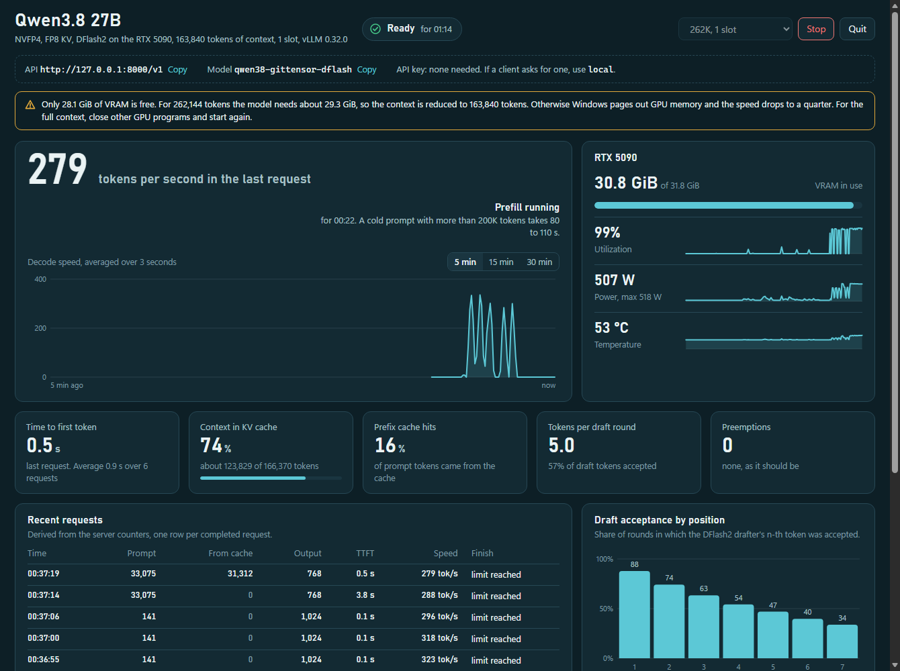
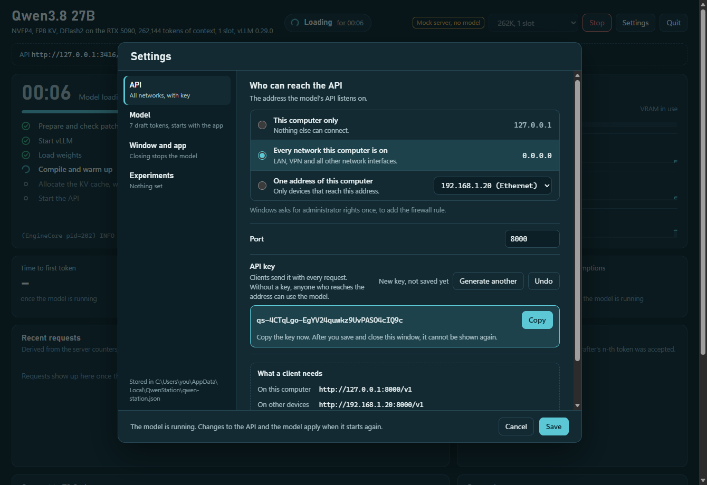

# Qwen Station

One file that installs and runs Qwen3.8 27B on a single RTX 5090, serves an OpenAI-compatible API and shows
what the model is doing. For Windows and for Linux.

**[Download the latest release](https://github.com/mfgAkilae/QwenStation/releases/latest)** and start the
file. Steps for [Windows](#install-on-windows) and for [Linux](#install-on-linux).



## Features

| Feature | What you get |
|---|---|
| **Set up with one click** | The setup installs the engine, the GPU kernels and the model without further questions, in 6 to 8 minutes on a fast connection. A newer version updates without a click. [Windows](#install-on-windows), [Linux](#install-on-linux) |
| **Fast answers** | A drafter proposes several tokens per round and the model keeps the right ones: about 160 tok/s for prose, 330 for code and 450 for reasoning, up to 554 with more draft tokens. [Speed](#speed) |
| **A long context that stays fast** | The model's full 262,144 tokens, also on Windows with a desktop on the same card: the KV cache is stored in 4 bit (NVFP4). The app sizes the context to the free VRAM, so the card never pages. [Context](#free-vram-decides-the-context-size) |
| **OpenAI-compatible API** | `http://127.0.0.1:8000/v1`, the unmodified vLLM endpoint. For this computer only by default; the settings open it for your network and generate an API key. [Settings](#settings) |
| **A live dashboard** | Decode speed, GPU, time to the first token, KV cache, cache hits, draft acceptance, the last requests and the server log. [What the window shows](#what-the-window-shows) |
| **Several requests at once** | Up to 4 slots that share the context. Four requests together reach about 1,370 tok/s. [Several requests at once](#several-requests-at-once) |
| **An orchestrator that comes first** | Optional: the main session of a coding agent keeps the full context and goes first, subagents get the rest. [Main session first](#main-session-first) |
| **Large sessions that take turns** | Kept in RAM, a session that another one pushed out of the GPU comes back in 1 second instead of 27. Made for two agents with 120,000 tokens each. [Sessions in RAM](#sessions-in-ram) |
| **Vision** | Optional: up to 4 images per request. [Vision](#vision) |
| **OpenCode adapter (test)** | Optional: a LoRA adapter that Hugging Face trained for OpenCode, served as a second model. Its model card reports more solved tasks with far fewer turns and tokens. [OpenCode adapter](#opencode-adapter-test) |
| **Your choice of coding agent** | T3 Code, OpenCode, Pi, DeepSeek Harness and Copilot in VS Code get the model with the right context size. None is touched until you switch it on in the settings; then Qwen Station only adds its own entry to its config. [Coding agents](#coding-agents) |
| **One settings window** | Network, API key, slots, RAM, vision, draft tokens and the coding agents in one place. There is a settings file and there are command line options too. [Settings](#settings) |
| **Stays out of your system** | On Windows it runs in a WSL distribution of its own, on Linux in one folder of your user. Both can be removed completely. [Remove](#remove) |

## What is inside

- **Model:** Qwen3.8 27B as NVFP4 (Gittensor build for the RTX 5090), NVFP4 KV cache (FP8 as an option), DFlash2 drafter for
  speculative decoding.
- **Engine:** vLLM 0.32.0 with six small patches and verified kernel tuning. The reasons and measurements are
  in [docs/engine-notes.md](docs/engine-notes.md).
- **Runs on LocalMaxxing**
  ([listed here](https://www.localmaxxing.com/en/models/gittensor-model-hub/Qwen3.8-27B-NVFP4-RTX5090)).
  Verified, one stream: 381.5 tok/s on `reasoning-v1` and 293 tok/s on `code-v1` with the default setting;
  439.9 and 290.5 tok/s with `draft_tokens` 15. With 4 slots and four streams at once: 1,324.6 tok/s on
  `reasoning-v1` and 976.7 on `code-v1`, all streams together. The site gives its Verified badge to single
  streams only, so these two are listed without it.

## Requirements

- NVIDIA RTX 5090 (32 GB) with a current driver. The model file and the kernels are built for this card.
- 45 GB of free space on a built-in drive, ideally an SSD
- Internet for the setup: about 30 GB of downloads
- **Windows:** Windows 11, or Windows 10 from version 21H2. WSL 2 from version 2.4.4; the setup installs or
  updates WSL if needed (see below).
- **Linux:** x86_64, any distribution with glibc 2.17 or newer, bash, tar. No Python needed: the app brings
  its own. A C++ compiler, make and curl; if they are missing, the setup names the one command that installs them.

## Install on Windows

1. Download `Qwen-Station-Setup-<version>.exe` from the
   [latest release](https://github.com/mfgAkilae/QwenStation/releases/latest) and start it. There is nothing
   to unpack. The file is not signed, so Windows SmartScreen warns: "More info", then "Run anyway".
2. The window lists what the machine needs and suggests a folder on the drive with the most free space.
   Click **Set up**.


That click is the only one. The setup then runs without further questions, and the model starts by itself
at the end. You can delete the downloaded file afterwards; the app starts from the Start menu.

| Step | What happens |
|---|---|
| App | Copies itself to `%LOCALAPPDATA%\Programs\Qwen Station`, adds Start menu and desktop shortcuts and an entry under Installed apps. No administrator rights needed. |
| WSL | Checks WSL. If it is missing, runs `wsl --install --no-distribution` (Windows asks for administrator rights). If Windows needs a restart, the app offers it and continues by itself after the next sign-in. An old WSL is updated. |
| Linux environment | Creates a WSL distribution named `QwenStation` in the chosen folder. Other distributions are not touched. |
| Engine | Installs a compiler, uv, Python 3.12, vLLM with PyTorch, the CUDA compiler, the patches and prebuilt GPU kernels. |
| Model | Downloads the model (17.9 GB) and the drafter (2.3 GB) from Hugging Face, pinned to fixed revisions. |

On a fast connection (about 35 MB/s) the whole setup took 7.5 minutes. Every step can be repeated: a cancelled or
failed setup continues where it stopped.

After the setup the model starts by itself. The first start takes two to three minutes, later starts 45 to 80 seconds.

A newer version updates an existing installation without a click: start the new exe, it replaces the app and
the changed parts of the engine and starts the model.

## Install on Linux

1. Download `Qwen-Station-<version>-x86_64.AppImage` from the
   [latest release](https://github.com/mfgAkilae/QwenStation/releases/latest).
2. Make it executable and start it. In the file manager: Properties, allow running it as a program, then
   double-click. In a terminal:

   ```sh
   chmod +x Qwen-Station-<version>-x86_64.AppImage
   ./Qwen-Station-<version>-x86_64.AppImage
   ```

The AppImage is the whole app in one executable file, with a Python of its own. There is nothing to unpack and
nothing needs root rights. At its first start it installs itself, so you can delete the downloaded file
afterwards; the app then starts from the menu or with `qwen-station`.

On a desktop with a browser the window opens; click **Set up**. Without one (a server, an SSH session) the
setup starts right away and prints its progress in the terminal.

| Step | What happens |
|---|---|
| App | The AppImage copies its content to `~/.local/share/qwen-station/app` (46 MB) and adds the command `~/.local/bin/qwen-station` and a menu entry. |
| Engine | uv, a Python 3.12 of its own, vLLM with PyTorch, the CUDA compiler, the patches and prebuilt GPU kernels, all below one folder (default `~/.local/share/qwen-station`). |
| Model | Downloads the model (17.9 GB) and the drafter (2.3 GB) from Hugging Face, pinned to fixed revisions. |

**Retrying an interrupted setup.** Start the AppImage again and use the same engine folder. From 2.1.2-rc.1
the app remembers a custom folder before starting the downloads. For a run interrupted on an older version,
select its original folder once. Under that folder:

- `models/` holds the target and drafter, including Hugging Face metadata and the station's hidden completion
  markers. Keep those files together. Setup skips completed model revisions.
- `cache/uv/` holds reusable packages. A retry can fetch incomplete or missing packages again.
- `bin/`, `python/`, `venv/` and `cuda-sdk/` hold the installed tools. Leave the installation at its existing
  path to reuse them. For a fresh engine in a different folder, copy `models/` and `cache/uv/` there first,
  including hidden files, with setup stopped.

During vLLM, CUDA and GPU kernel installation, the dashboard and terminal show how many MiB uv has written
every ten seconds. These include unpacked files. The last package name can belong to any parallel download.
After three minutes without observed CPU or I/O activity and with no build subprocess, setup retries once
with one download at a time. A second stall in a required step shows the cache location and a retry action.

After an interrupted first installation, **Change folder** returns to the location field. **Try again**
uses the existing folder and its cache.

If the system has no C++ compiler, the setup tries `sudo` without a password and the graphical password prompt.
If neither works it stops and shows the command to run once, for example
`sudo apt-get update && sudo apt-get install -y build-essential curl ca-certificates`. Then start the setup again.

Options go after the file name and on to the app:

```sh
./Qwen-Station-<version>-x86_64.AppImage --setup --location /data/qwen-station   # another folder, no click
qwen-station --no-window                                                         # later: start without a window
```

An AppImage mounts itself with FUSE (`fusermount`), which desktop distributions bring along. Where it is missing
(containers, minimal servers) the start says so; start the file once with `--appimage-extract-and-run` as its
first option instead. The installed app does not need FUSE.

**NixOS** (not tested by us): an AppImage runs there through `appimage-run` (`programs.appimage` with
`enable = true;` and `binfmt = true;`). Since 2.1.1 the setup also finds the NVIDIA driver below
`/run/opengl-driver/lib`, where NixOS keeps it; a NixOS user ran the setup and the model with a test build of
2.1.1. If the setup still stops at "CUDA compiler" with "libcuda.so of the NVIDIA driver is missing", give
`appimage-run` the driver package, as that user did before:

```nix
programs.appimage = {
  enable = true;
  binfmt = true;
  package = pkgs.appimage-run.override {
    extraPkgs = pkgs: [ config.hardware.nvidia.package ];
  };
};
```

A newer version updates an existing installation the same way: start the new AppImage, it replaces the app and
the changed parts of the engine. That also works for an installation made with the `.run` file of 1.1.0 or 1.2.0.

Without a desktop the dashboard is still there at `http://127.0.0.1:8010/`; reach it from another machine with
`ssh -L 8010:127.0.0.1:8010 <host>`. Ctrl+C, `kill` or a closed terminal stop the model in order. To keep it
running after you log out, start it in `tmux` or with `nohup qwen-station --no-window &`.

In a test on Ubuntu 24.04 the setup took 6 minutes on a 35 MB/s connection and used 28 GB.

## Use

### Coding agents

Qwen Station enters the model in the coding agents you choose, at every start of the model and right after you
change the choice: **Settings, Coding agents**. None is switched on by default: until you choose an agent, Qwen
Station changes no agent config. An agent you switch on that is not on the computer yet gets the model once it is
installed. Up to 2.0.0 all five were on by default; after an update, Qwen Station keeps updating the agents that
already have the model, until you change the choice.

| Agent | What Qwen Station writes | Where you pick the model |
|---|---|---|
| **T3 Code** | Nothing of its own: T3 Code runs OpenCode and Pi, so it keeps their entries up to date, even when those two are switched off | Provider OpenCode or Pi, model `vllm/qwen38-gittensor-dflash` |
| **OpenCode** | Provider `vllm` in `~/.config/opencode/opencode.json`, with the reasoning levels this model knows | `/models`, `vLLM RTX 5090` |
| **Pi** | Provider `vllm` in `~/.pi/agent/models.json` | `/model`, `vllm/qwen38-gittensor-dflash` |
| **DeepSeek Harness** | Provider `qwen-station` in the desktop profile, `~/.dsh/profiles/desktop/cordis.patch.yml` | Model selector, `vLLM RTX 5090` |
| **Copilot in VS Code** | A "Custom Endpoint" group `Qwen Station` in `chatLanguageModels.json` of VS Code's user folder (also VS Code Insiders) | Chat model picker, under `Qwen Station` |

Every entry carries the address, the context the model really has, the output limit, whether it takes images,
and the reasoning levels `low`, `medium` and `xhigh`.

- **It only adds.** Qwen Station writes its own entry and leaves everything else in these files as it is, comments
  in DeepSeek Harness's YAML included. Before its first change to a file it keeps a backup next to it
  (`<file>.bak-station-<date>`). DeepSeek Harness and Copilot get a provider of their own, so an update never
  touches one you made. Switching an agent off stops the updates; its entry stays where it is.
- **A config that holds a plain-text secret** (OpenCode) or that Qwen Station cannot read safely (YAML written in
  flow style) is not changed; the dashboard says so.
- **API key:** OpenCode gets a reference to a file that holds it, Pi the key itself. DeepSeek Harness finds keys
  by name: its provider names `QWEN_STATION_API_KEY`, and Qwen Station puts that line into `~/.dsh/.env` (the
  placeholder `local` without a key, as DeepSeek Harness refuses a provider without one). VS Code keeps keys
  itself: enter the key once under Chat, Manage Models.
- The panel **Use it in your coding agents** in the window shows the state of every agent you switched on.
- **Subagents:** with [Main session first](#main-session-first) on, every agent you switched on also gets the model
  `qwen38-gittensor-dflash-subagent` (in T3 Code, OpenCode and Pi `vllm/qwen38-gittensor-dflash-subagent`).
  Choose it where your agent sets the model of its subagents, for example `agent.<name>.model` in OpenCode or
  the model of a delegated task in T3 Code. The entry stays when you switch the setting off; the name then works
  like the main model.
- **OpenCode adapter:** with [the adapter](#opencode-adapter-test) on, OpenCode (and T3 Code through it) also gets
  the model `vllm/qwen38-gittensor-dflash-opencode`, without reasoning levels.

### Other clients

- Base URL `http://127.0.0.1:8000/v1`, any API key (for example `local`). If you set an API key in the settings,
  clients must send that one.
- Reasoning effort: `low`, `medium` or `xhigh`. This checkpoint knows no other levels.
- vLLM rejects `min_p` and `logit_bias` with HTTP 400 while speculative decoding is active.

Closing the window stops the model and frees the VRAM. A minimized window keeps it running. Starting the
app a second time only shows the window again.

### What the window shows

- Decode speed live (tok/s, averaged over 3 seconds) with a history of 5, 15 or 30 minutes
- GPU: VRAM, utilization, power, temperature
- Time to first token, KV cache fill level, prefix cache hit rate, tokens per draft round, preemptions
- The last requests: prompt tokens, cached tokens, output tokens, TTFT, speed, finish reason
- Draft acceptance per position of the DFlash2 drafter
- The server log, with a filter for warnings and errors

All values come from the `/metrics` endpoint of the vLLM server. Nothing sits in the request path: the API
is the unmodified vLLM endpoint. One exception: on Windows, requests from other devices pass through a relay in
the app, which hands the bytes on unchanged (see [Settings](#settings)).

### Free VRAM decides the context size

The card has 31.8 GiB. Beside its KV cache the model takes 20.3 GiB at the start and up to 21.3 GiB after long
sessions, and Windows starts paging GPU memory about 0.65 GiB before the card is full. So Qwen Station keeps
22 GiB for that and gives the rest to the KV cache. How much context that is depends on how the cache stores keys
and values: NVFP4 (4 bit, the default since 2.0) holds about 1.8 times as many tokens per GiB as FP8.

| Free at start (Windows) | Context with NVFP4 (default) | Context with FP8 |
|---|---|---|
| 31.95 GiB | 262,144 tokens, the model's full context | 262,144 |
| 30.9 GiB | 262,144 | 229,376 |
| 29.9 GiB | 262,144 | 196,608 |
| 28.9 GiB | 262,144 | 163,840 |
| 28.3 GiB | 262,144 | 131,072 |
| 27.7 GiB | 229,376 | 98,304 |
| 27.2 GiB | 196,608 | 98,304 |
| 26.6 GiB | 163,840 | 65,536 |
| 26.0 GiB | 131,072 | 65,536 |
| 25.4 GiB | 98,304 | too little: no automatic start |
| 24.9 GiB | 65,536 | too little |
| less | too little: no automatic start | too little |

Each step down is 32,768 tokens; the window says so, and the coding agents get the smaller limit. Below the
last row the window lists the programs that hold the most GPU memory. On Linux, which does not page GPU memory,
0.5 GiB less is kept.

With NVFP4 a desktop with a browser on the same card (1 to 3 GiB) still leaves the full context. With FP8 the full
context needs a card that runs nothing else, and 163,840 or 196,608 tokens are the usual result.

The reason for the reserve: if the model does not fit, Windows pages GPU memory. That does not show at once.
Up to version 1.5.0 the full context started whenever 29.3 GiB were free; with 30.1 GiB free the card then ran
full, short prompts were as fast as ever, and a session of 163K tokens decoded at 83 instead of 380 tok/s.
On Linux the server runs out of GPU memory instead. "Fit the context to the free VRAM" in the settings switches
the automatic off; the preset then starts as it is.

The context is usable to its end. Up to version 1.5.0 the KV cache was 2 percent too small for that: a request
of more than about 97 percent of the context never got an answer, because it ran out of cache blocks and
started over, again and again. Now a prompt of 99.7 percent of the context is answered (FP8), and with NVFP4 one
of 99.5 percent of 262,144 tokens filled the cache to 95 percent; a longer one gets an error at once.

### The KV cache: NVFP4 or FP8

**Settings, Model, KV cache** (`kv_cache`, `--kv-cache`). NVFP4 stores keys and values in 4 bit with one scale per
16 values, FP8 in 8 bit. vLLM 0.32 reads an NVFP4 cache with the same fast decode kernel (XQA) on the RTX 5090.
Measured on 2026-11-17:

| | FP8 | NVFP4 |
|---|---|---|
| Tokens per GiB of KV cache | 32,400 | 58,000 |
| KV cache Qwen Station gives one request of 229,376 tokens | 8.9 GiB | 5.7 GiB |
| Draft rounds per second (short prompt, 137K) | 65, 54 | 65, 52 |
| Tokens kept per round, reasoning (short, 33K, 137K) | 6.9, 6.4, 6.1 | 6.8, 5.8, 6.1 |
| Reading 137K tokens cold | 34 s | 34.4 s |
| 8 and 16 codes hidden in 200K tokens, 16 in 100K | all found | all found |

The figures are single runs; decode speeds differ by up to 10 percent between runs either way. The drafter keeps
as many tokens per round as with FP8. FP8 stays as the setting for anyone who wants the format of Qwen Station 1.x.

## Settings

The **Settings** button in the window opens them:



- **Who can reach the API:** this computer only (`127.0.0.1`, the default), every device that can reach this
  computer (`0.0.0.0`, all network interfaces), or one address of this computer, for example the one of your LAN
  or of a VPN. The list shows the addresses the computer has.
- **API key:** "Generate a key" creates one and shows it once: copy it then. After you save and close the
  settings, the app does not show it again; you can only replace or remove it. Clients send the key with every
  request (`Authorization: Bearer <key>`, the API key field of an OpenAI-compatible client). Without a key,
  anyone who can reach the address can use the model, so set one before you share the API.
- **Vision:** switches the model's image encoder on, see [Vision](#vision).
- **OpenCode adapter (test):** serves a LoRA adapter trained for OpenCode as a model of its own, see
  [OpenCode adapter](#opencode-adapter-test).
- **Requests at the same time:** 1 to 4 slots, see [Several requests at once](#several-requests-at-once).
- **Sessions kept in RAM:** a large session that another one pushed out of the GPU comes back in a second
  instead of being read again, see [Sessions in RAM](#sessions-in-ram).
- **Coding agents:** which agents get the model, see [Coding agents](#coding-agents). A change applies at once.
- The API port, draft tokens per round, the automatic context reduction, the start of the model with the app,
  what happens when the window closes, the port of the dashboard, and extra arguments and environment for
  experiments.

The areas on the left show the current state at a glance. Changes to the API and the model apply when the model
starts; while it runs, the window offers to restart it. The port of the dashboard applies the next time Qwen
Station starts.

What the key does and does not protect: vLLM checks it for everything below `/v1` (chat, completions, the model
list). The metrics and the health check stay open, which is how the dashboard reads them. The key travels in
clear text, as the API speaks plain HTTP: use it on networks you trust or behind a VPN, not across the internet.
The app has to keep the key to start the server with it, so it stays in the settings file, readable for your
user account. The server gets it through its environment, never on a command line. How each coding agent
gets it is under [Coding agents](#coding-agents); for OpenCode it is the file `api-key` next to the settings file.

- **Windows:** the model runs inside WSL, which Windows reaches at `127.0.0.1` only. For other devices the app
  itself listens on the chosen address and passes connections on. Windows asks for administrator rights once,
  to add a firewall rule for that address and port: for all interfaces the rule covers private and domain
  networks, not public ones; for a single address it covers that address. Going back to "this computer only"
  removes the rule again (one more prompt). Windows cancels an unanswered prompt after two minutes; the model
  then starts without the rule, and the next start asks again.
- **Linux:** the server binds the chosen address itself. The firewall is yours to open. With a single address
  the API no longer answers on `127.0.0.1`; the app and the registered clients then use that address.

The settings are stored in `%LOCALAPPDATA%\QwenStation\qwen-station.json`, on Linux in
`~/.config/qwen-station/qwen-station.json`. You can edit the file as well. All keys are optional:

```json
{
  "preset": "262k",
  "close_action": "stop",
  "autostart": true,
  "api_host": "127.0.0.1",
  "api_key": "",
  "fit_context": true,
  "kv_cache": "nvfp4",
  "api_port": 8000,
  "station_port": 8010,
  "agents": [],
  "extra_args": "",
  "extra_env": ""
}
```

- `preset`: `262k` (default), `237k` (about 0.8 GB more VRAM headroom) or `unsloth-82k` (Unsloth's NVFP4 build
  with the same drafter; needs `provision.sh model-unsloth` first: inside the distribution on Windows, in the
  engine folder on Linux). The earlier preset `parallel-96k` is now the setting `slots`.
- `slots`: how many requests the server works on at the same time, 1 (default) to 4. See
  [Several requests at once](#several-requests-at-once).
- `main_first`: `true` keeps the full context for the main session of a coding agent; subagents get the rest.
  Needs `slots` of 2 or more. See [Main session first](#main-session-first).
- `kv_cache`: `nvfp4` (default) or `fp8`, how the KV cache stores keys and values. See
  [The KV cache: NVFP4 or FP8](#the-kv-cache-nvfp4-or-fp8).
- `ram_cache_gib`: how many GiB of RAM hold sessions that left the GPU, 0 (default, off) to 128. See
  [Sessions in RAM](#sessions-in-ram).
- `agents`: the coding agents that get the model, any of `t3code`, `opencode`, `pi`, `deepseek` and `copilot`
  (default: none, `[]`, so no agent config is touched). The older switch `register_clients: false` means `[]`.
- `close_action`: `stop` ends the model when the window closes, `keep` leaves it running until **Quit**.
- `api_host`: `127.0.0.1` (default), `0.0.0.0` or one IPv4 address of this computer, as described above.
  The older switch `lan: true` still works and means `0.0.0.0`.
- `api_key`: empty (default, no key) or 8 to 128 characters: letters, digits and `. _ ~ + / = -`. In the file
  you can also set a key of your own.
- `fit_context`: `false` switches the automatic context reduction off.
- `vision`: `true` loads the image encoder, so requests may contain images. See [Vision](#vision).
- `opencode_adapter`: `true` serves the OpenCode adapter as the model `qwen38-gittensor-dflash-opencode`. See
  [OpenCode adapter](#opencode-adapter-test).
- `draft_tokens`: how many tokens the drafter proposes per round, 7 by default, up to 15. More makes reasoning
  17 to 30 percent faster and costs 0.17 GiB of KV cache each (about 10,000 tokens of context with NVFP4,
  5,400 with FP8), see [Speed](#speed).
- `extra_args`: appended to `vllm serve`. `extra_env`: `KEY=VALUE` pairs for the start script, for example
  `XQA_DECODE=0`.

The same values work as command line options: `Qwen-Station.exe --preset 237k --keep --no-autostart`, on Linux
`qwen-station --preset 237k --no-autostart`. `--check` prints the state of the installation as JSON and exits.
`--setup` starts a needed setup without the click, `--location` names its folder. `--api-host 0.0.0.0` sets
the address of the API for one run, `--kv-cache fp8` the KV cache, `--main-first` and `--opencode-adapter` the
settings of those names, `--agents opencode,pi` the coding agents, and `--no-register-clients` leaves every agent
alone.

## Speed

Speculative decoding makes the speed depend on the text: the drafter proposes several tokens per round, the
model keeps the ones it would have written itself. The server does about 61 rounds per second with a short
context and 54 behind 137K tokens. Predictable text keeps more tokens per round.

Measured on 2026-11-17 with `tools/bench.py` (greedy, 768 output tokens, reasoning effort at its default, RTX
5090, context limit 163,840 tokens). Decode tokens per second, in brackets the tokens kept per round:

| Text the model writes | Short prompt | Behind 33K tokens | Behind 137K tokens |
|---|---|---|---|
| Prose (an essay) | 160 (2.5) | 217 (3.5) | 192 (3.5) |
| Code (a module with tests) | 331 (5.2) | 349 (5.7) | 238 (4.5) |
| Reasoning (a problem, step by step) | 451 (6.9) | 391 (6.4) | 323 (6.1) |

Reading the long contexts cold: 9,170 tok/s for 33K tokens (3.6 s), 4,060 tok/s for 137K tokens (34 s). With the
prefix in the cache the first token comes after 0.3 and 1.2 seconds.

### More draft tokens per round

The drafter was trained for blocks of 8 (7 draft tokens), but it keeps proposing useful tokens beyond that.
`draft_tokens` raises the number. Each round then takes a little longer, and the KV cache needs a state per
extra token, which costs context:

| `draft_tokens` | Prose | Code | Reasoning | Rounds per second (short, 137K) | Context with 28.6 GiB free (Windows), NVFP4 / FP8 |
|---|---|---|---|---|---|
| 7 (default) | 160, 217, 192 | 331, 349, 238 | 451, 391, 323 | 65, 54 | 262,144 / 131,072 |
| 9 | 147, 206, 190 | 318, 298, 295 | 509, 461, 332 | 62, 53 | 229,376 / 131,072 |
| 11 | 155, 188, 176 | 381, 280, 254 | 527, 443, 403 | 61, 47 | 229,376 / 131,072 |
| 15 | 153, 216, 165 | 374, 300, 278 | 554, 461, 419 | 60, 46 | 196,608 / 98,304 |

The three numbers per cell are tok/s for a short prompt, behind 33K and behind 137K tokens. Reasoning gains 17 to
30 percent with 11 or 15 draft tokens at every context size. Code gains with short prompts and varies behind long
contexts (these are single runs; code differs between runs). Prose loses up to 14 percent, because it keeps few
tokens anyway and the rounds get slower. The default stays 7: the largest context and the best speed for prose.

### Vision

The checkpoint contains an image encoder (27 layers, not quantized). By default it is not loaded. With
**Vision** switched on in the settings (or `--vision`), a request may contain up to 4 images, in the usual
OpenAI format (`image_url` parts in the message, as a `data:` URL or a link). Video stays off.

Measured on 2026-11-17 (RTX 5090, context limit 163,840 tokens):

| Image | Tokens in the prompt | Time to the first token | VRAM while it is read |
|---|---|---|---|
| 1024 x 1024 | 1,076 | 0.2 s | no change |
| 1920 x 1080 | 2,092 | 0.4 s | no change |
| 3840 x 2160 (a 4K screenshot) | 8,212 | 2.0 s | +0.54 GiB |
| 4096 x 4096, the largest; bigger images are scaled down to it | 16,436 | 10.5 s | +0.75 GiB |

What it costs:

- **Context.** The encoder's weights take 0.86 GiB of VRAM and reading a large image up to 0.75 GiB more. Qwen
  Station reserves 1.7 GiB for vision, so the context gets one or two steps of 32,768 tokens smaller: with
  30.9 GiB free, 163,840 instead of 229,376 tokens.
- **Speed of text: nothing.** With vision on and no image in the request, the speed is the same (short prompts:
  314 tok/s for code and 451 for reasoning, against 328 and 437 without vision; behind 33K tokens 365 against 372).
- **Speed of answers about images:** about 200 tok/s after a small image, 110 to 130 after 16,000 image tokens.
  The drafter does not see the image, so fewer of its tokens are kept.
- **The first start with vision** takes about two and a half minutes instead of one: vLLM compiles the model
  once more, into a cache of its own.

In a test the model named the colours and positions in a generated picture, kept two images apart in their
order, and read the speed, the GPU and the VRAM figure off a screenshot of the dashboard. With vision on, the
entries of the coding agents say that the model takes images.

### OpenCode adapter (test)

[harness-hub/Qwen3.8-27B-opencode-adapted](https://huggingface.co/harness-hub/Qwen3.8-27B-opencode-adapted) is a
LoRA adapter for Qwen3.8 27B that Hugging Face trained with reinforcement learning as the model behind OpenCode.
Its model card reports, under OpenCode with thinking off: SWE-bench Pro (the 51 hard tasks) 51.0 % instead of the
model's 35.3 %, Terminal-Bench 2.1 52.4 % instead of 46.4 %. That is about as accurate as the model thinking at
`xhigh`, with 6 to 8 times fewer generated tokens per task.

With **OpenCode adapter (test)** switched on in the settings (or `--opencode-adapter`), the server loads it beside
the model and answers to a third name, `qwen38-gittensor-dflash-opencode`. Requests for the other names do not use
it. The first start with the setting downloads it (660 MB, a pinned revision).

- **OpenCode and T3 Code** get an entry for it, without reasoning levels: the server runs it without thinking, as
  it was trained, unless a request asks for thinking. Pi, DeepSeek Harness and Copilot do not get it. Switching
  the setting off leaves the entry, as Qwen Station never deletes one; OpenCode then gets an error for that model.
- **Its own chat template.** The checkpoint here ships a chat template of its own, which words the tool
  instructions differently from the Qwen template the adapter learned. A local patch
  (`patch-vllm-adapter-template.py`) renders the adapter's requests with the template that comes with it.
- **Not evaluated on this build.** The adapter was trained and evaluated on the BF16 model; this one is NVFP4.
  Whether the gains hold here is open, which is why the setting is marked as a test.

Measured on 2026-11-20 (vLLM 0.32.0, RTX 5090, greedy, no thinking, a Python module with tests and a TypeScript
class, 700 tokens each, two runs). Decode tok/s, in brackets the tokens kept per round:

| Server | Requests for the model | Requests for the adapter |
|---|---|---|
| Without the adapter | 391 (6.2) | |
| With the adapter | 348 (6.2) | 278 (6.0) |

What it costs:

- **VRAM.** The weights take 18.54 instead of 18.02 GiB. Qwen Station reserves 0.6 GiB for the adapter, so the
  context can get one step of 32,768 tokens smaller.
- **Speed.** Requests for the adapter decode about 29 % slower than the model on a server without it; while the
  adapter is loaded, the model's own requests are about 11 % slower too. The drafter keeps as many tokens per
  round as before: it does not use the adapter, and the adapter's code stays predictable for it.
- **The first start** compiles the model once more for the new configuration, about a minute.

The adapter pays off if it needs fewer turns and tokens per task, as the model card says, also on NVFP4. A first
sign, small and from one task: OpenCode 2.3.2 fixed a failing unit test (a slug function that neither collapses
nor strips its hyphens) three times with each model, all six runs with the tests passing afterwards. Medians:

| | Time | Requests | Generated tokens |
|---|---|---|---|
| The model, reasoning `medium` | 132 s | 53 | 19,244 |
| The adapter, no thinking | 50 s | 19 | 4,394 |

### Several requests at once

By default the server works on one request at a time; a second one waits. The setting **Requests at the same
time** (`slots`, `--slots`) raises that to up to 4.

The slots share the KV cache. A slot by itself costs nothing: the cache is one pool, and vLLM takes from it for
every request that runs. Each running request needs about 1.6 GiB for its own state (the room of 94,000 tokens
with NVFP4, 52,000 with FP8), plus its text. With more than one slot the pool gets all the VRAM the 22 GiB
reserve leaves, not only what one request of the full context needs. With NVFP4 that means:

| Running at the same time | Tokens they hold together, 28.6 GiB free | 30.4 GiB free (nothing else on the card) |
|---|---|---|
| 1 request | 262,144 (its limit) | 262,144 |
| 2 requests | about 208,000 | about 262,000 or more |
| 3 requests | about 116,000 | about 223,000 |
| 4 requests | about 24,000 | about 131,000 |

**Two context windows at the same time.** With 2 slots and 30.4 GiB free, two sessions of 149K tokens ran side
by side (measured 2026-11-17): both found the code word in their own document, nothing was pushed out. Reading
the prompts shares the GPU: both were read after 79 seconds, as fast as one after the other. The session that
finished reading first decoded at about 20 tok/s while the other one still read, then both at full speed.
So two agents can each keep a long session open and work at the same time; when both send a new long prompt
at the same moment, neither gets it faster.

A single request may still use the whole context. If requests do not fit together, nothing fails: the later
one waits until there is room, and reads its context again if that was pushed out of the cache
([Sessions in RAM](#sessions-in-ram) takes that reading away).

Measured on 2026-11-17 (decode tok/s; short prompts unless stated):

| Case | Per request | All together |
|---|---|---|
| 1 request | 350 to 490, depending on the text | |
| 2 at once | 332 to 347 | 653 to 680 |
| 4 at once | 344 to 449 | 1,365 to 1,376 |
| A session of 163K tokens and a short request at once | 380 and 200 | |
| The same two, one after the other (1 slot) | 390 and 480 | |
| Sessions of 163K and 113K tokens at once, which do not fit together | 385 and 400 | the second one waited 30 to 53 s |

The same on LocalMaxxing, measured with its own tool on 2026-11-17 (four streams, five rounds): 1,324.6 tok/s
on `reasoning-v1` (1,235 to 1,355) and 976.7 on `code-v1` (897 to 1,079), against 381.5 and 293 with one stream.
Its decode matrix, which writes plain prose, gave 201, 395 and 679 tok/s for 1, 2 and 4 streams
([run](https://www.localmaxxing.com/en/inference-benchmarks/cmwkp22m807z3mi015s8glsuu)).

How many requests really run at once depends on the pool: four requests need about 6.2 GiB for their own state
before their first token, so four long sessions at once need a card that runs nothing else, or fewer slots.

Requests that run together move at the pace of the longest context among them, so a short request beside a
long session gets about half its usual speed. Answers can differ in single words from the ones the same request
gets alone (in the tests one to two of four did): batches are computed slightly differently, as in vLLM without
a drafter. More draft tokens per round and vision work with several slots.

### Main session first

**Settings, Model, Main session first** (`main_first`, `--main-first`; off by default, needs 2 slots or more).
For a coding agent that hands work to subagents: its main session, the orchestrator, always has room for the
model's full context and is served first. Subagents get what is left.

The server answers to a second model name for this, `qwen38-gittensor-dflash-subagent`. It is the same loaded
model under another name, so it costs no VRAM, and both names share the KV cache. The name is how the server tells
the two apart: there are no fixed slots, and every turn of an agent is a request of its own. Choose that model for
the subagents of your agent (see [Coding agents](#coding-agents)). Then:

- A request of the main session that finds no free slot, or no room for its context, pushes out the subagent
  request that came last. The subagent goes on where it stopped as soon as there is room again; with
  [Sessions in RAM](#sessions-in-ram) its KV is copied back instead of read again.
- In every step the main session is served before the subagents.
- The subagent model has a context of its own: the room beside a main session of the full context, but at
  least 65,536 tokens. A longer prompt gets vLLM's usual error ("This model's maximum context length is ..."),
  which coding agents take as the signal to compact. The window shows both numbers under the setting and in the
  panel of the agents.

With NVFP4 and 262,144 tokens for the main session (Windows):

| Free at start | Subagents get | Beside a main session of the full context |
|---|---|---|
| 31.95 GiB (nothing else on the card) | 115,712 tokens | fits |
| 31.5 GiB | 90,112 tokens | fits |
| 31.0 GiB or less | 65,536 tokens | does not fit: while the main session uses most of its context, subagents wait |

With a desktop on the same card (28.6 GiB free), a subagent of 65,536 tokens
runs beside a main session of up to about 120,000 tokens, and waits while the main session is longer.

Measured on 2026-11-17 with that pool (6.6 GiB, 2 slots), against first come, first served:

| Case | First come, first served | Main session first |
|---|---|---|
| Two subagents that write take both slots, the main session sends a short request | first token after 25.4 s | after 0.1 s |
| A subagent of 59K tokens writes 6,000 tokens, the main session sends 199K tokens; both do not fit together | first token after 117 s: it waited for the subagent | after 67 s, its own reading time; the subagent paused and finished after it |

The subagent that paused came back with 1.3 GB copied from RAM; without sessions in RAM it read its prompt
again and finished 16 seconds later. A subagent prompt of 69K tokens got the error above, the same prompt on the
main model an answer.

What it does not do: while the main session waits for its subagents, no request of it runs, and its context is
only cached. Subagents may then push that cache out of the GPU. With sessions in RAM it comes back in about a
second per 100,000 tokens, without them the main session reads it again.

### Sessions in RAM

The KV cache on the GPU has room for one large session. When two take turns, for example two agents with
120,000 tokens each, each one pushes the other out, and at its next request the server reads the whole
context again: 27 seconds for 119,000 tokens, every time.

With **Sessions kept in RAM** (`ram_cache_gib`, `--ram-cache-gib`; off by default) the server copies what
leaves the GPU to RAM and copies it back when the session returns. Measured on 2026-11-17 with 24 GiB:

| Two sessions in turns | Without | With sessions in RAM |
|---|---|---|
| 119K tokens each: time to the first token | 26.5 s | 1.1 s |
| The same: how much of the prompt comes from the cache | 0 percent | 98 percent |
| The same: decode speed | 417 to 437 tok/s | 407 to 417 tok/s |
| Two conversations of 109K tokens that grow turn by turn: time per switch | 23 s | 1.0 s |
| 174K tokens each (context 196,608): time to the first token | 52 s | 1.8 s |

The answers were the same as on the first visit, and each session found the code word hidden in its own
document. About 1,900 tokens at the end of a session are read again after it comes back. It works together
with several slots and more draft tokens: with 2 slots and 15 draft tokens, three sessions of 59K tokens in
turns took 0.6 seconds per switch instead of 8.1, and two of 94K tokens 1.0 instead of 17 to 21.

What it costs:

- **RAM.** About 3.5 GiB per 100,000 tokens that are kept. The whole amount is taken when the model starts,
  which makes the start about 15 seconds longer. When it is full, the oldest blocks go: a cache too small for
  the sessions behaves like none (three sessions of 99K tokens with 4 GiB were read again each time, without
  an error).
- **On Windows the RAM comes out of WSL's share.** WSL gives Linux half of the PC's RAM unless
  `%UserProfile%\.wslconfig` says otherwise (`memory=`), and the cache has to fit into half of that. On a PC
  with 128 GB that allows about 30 GiB, with 64 GB about 15. If the amount does not fit, the model starts
  without the cache and the log says so.
- **Nothing on the GPU.** The context and the speed of a single session stay as they are.

It works with several slots as well (measured 2026-11-17 with NVFP4 and 24 GiB): with 2 slots, two sessions of
149K tokens at once, then two others, then the first two again: they came back with 98 percent from RAM and
their first tokens after 2.0 and 3.6 seconds instead of 46 and 78. With 4 slots, four sessions of 24K tokens
came back with 85 percent from RAM after 0.9 to 1.9 seconds. The answers were the same as on the first visit.

It does not make the context larger: one request still has the limit of the context. It removes the wait
when sessions take turns. It needs a patch to vLLM, which Qwen Station applies;
[engine-notes.md](docs/engine-notes.md) has the details.

### Measure it yourself

```sh
python tools/bench.py --markdown                 # about five minutes against http://127.0.0.1:8000
python tools/bench.py --contexts 0 --repeats 3   # the short prompts only
```

With an API key in the settings, pass it with `--api-key` or in the variable `QWEN_API_KEY`.

The prompts are fixed and in the script. A row is marked when other requests ran on the server at the same time.

## Remove

Windows:

- **App:** Windows Settings, Apps, Installed apps, uninstall "Qwen Station".
- **Engine and model** (about 32 GB): `wsl --unregister QwenStation` in PowerShell.
- **Settings and logs:** delete `%LOCALAPPDATA%\QwenStation`.

Linux:

- **App:** `qwen-station --uninstall` removes the app files, the command and the menu entry.
- **Engine and model** (about 28 GB): delete the engine folder, by default `rm -rf ~/.local/share/qwen-station`.
- **Settings and logs:** delete `~/.config/qwen-station`.

## How it is built

Plain Python (3.10 or newer), standard library only. The Windows exe is a PyInstaller one-file build. The Linux
file is an AppImage: the same Python package and a standalone Python 3.12, behind the static AppImage runtime.

| Path | Purpose |
|---|---|
| `qwen_station/app.py` | HTTP API for the dashboard, polling, window handling, entry point |
| `qwen_station/setup.py` | First-run setup: requirements, progress of the provisioning; WSL and the distribution on Windows, one folder on Linux |
| `qwen_station/installer.py` | Installs and removes the app itself (per user, no administrator rights) |
| `qwen_station/settings.py` | The settings of the menu: valid values, the addresses of this computer, when a change applies |
| `qwen_station/relay.py` | Windows: passes connections from other devices on to the server inside WSL |
| `qwen_station/setup-qwen-lan.ps1` | Windows: the firewall rule for a shared API |
| `qwen_station/supervisor.py` | Preflight, start of the server (inside WSL or directly), startup phases from the log, stop |
| `qwen_station/metrics.py` | Parses `/metrics`; speed and request rows from counter differences |
| `qwen_station/gpu.py` | `nvidia-smi` readings, GPU memory per Windows process |
| `qwen_station/clients.py` | The entries in the coding agents; only adds, and edits DeepSeek Harness's YAML as text, as the app has no YAML library |
| `qwen_station/dashboard.html` | The dashboard: one file, no external resources |
| `qwen_station/engine/provision.sh` | Installs the engine below one prefix. Idempotent, also runs on native Linux. |
| `qwen_station/engine/serve.sh` | Starts `vllm serve` with the tested settings |
| `qwen_station/engine/patches/` | Eight idempotent patches for vLLM; each file explains its reason |
| `qwen_station/engine/autotune/` | Verified FlashInfer kernel tuning |
| `qwen_station/engine/engine.env` | Version pins: vLLM, Python, uv, CUDA packages, model revisions |

The reasons behind the engine settings, with the measurements, are in [docs/engine-notes.md](docs/engine-notes.md).

The dashboard listens on `127.0.0.1` only. Start, stop, setup and quit need a token that exists only in the
served page, so other websites cannot control the app.

### Develop

```powershell
python run-station.py --mock            # fake server instead of the model: the dashboard without a GPU
python run-station.py --check           # state of the installation as JSON
python -m unittest discover -s tests    # includes starting the mock server as a real subprocess
.\build-exe.ps1 -Release                # dist\Qwen-Station-Setup-<version>.exe with its SHA256 file
python3 build-linux.py                  # on Linux: dist/Qwen-Station-<version>-x86_64.AppImage with its SHA256 file
```

To run the dashboard regression tests, start a separate station with `--mock --no-autostart --no-window --keep`.
Set `QWEN_STATION_TEST_URL` to its dashboard URL. With Node.js, `playwright-core` and Chromium available,
set `CHROME_PATH` to the browser executable and run `node --test tests/dashboard.cjs`. The suite starts
and stops the mock model and exercises the settings dialog.

`build-exe.ps1` creates its own venv in `.build\` and installs PyInstaller there. `build-linux.py` runs on Linux
(WSL works) and needs `mksquashfs` from the package squashfs-tools. It downloads two files, pinned by SHA256: the
Python from [python-build-standalone](https://github.com/astral-sh/python-build-standalone) and the runtime from
[AppImage/type2-runtime](https://github.com/AppImage/type2-runtime). The tests pass on Windows and Linux; the
ones about WSL and Windows paths are skipped on Linux.

## License

Qwen Station is released under the [MIT License](LICENSE).

It does not ship vLLM, PyTorch or the model weights. The setup downloads them from PyPI and Hugging Face, and
each keeps its own license: vLLM, the model (`gittensor-model-hub/Qwen3.8-27B-NVFP4-RTX5090`) and the drafter
(`TechPrototyper/Qwen3.8-27B-DFlash2-fp8-vllm`) are Apache 2.0. The scripts in `qwen_station/engine/patches/`
change the installed vLLM on your machine.

The Linux AppImage contains two parts from others, unchanged: CPython 3.12 as built by python-build-standalone
(Python Software Foundation License, with the licenses of the libraries built into it) and the AppImage runtime
(MIT License).

## Tested, and not tested

On 2026-11-19 the 2.1.2-rc.2 Windows executable and Linux AppImage each passed seven Chromium dashboard
tests, including mock model start/stop, settings validation, failed actions, clipboard fallback and slow
status requests. A separate AppImage run under WSL exercised a failed native setup, the timer after failure,
and selecting another folder for a retry.

On 2026-11-19, the 2.1.2-rc.1 AppImage ran in native Linux mode under WSL. With uv 0.12.9 and a local
wheel index, the dashboard showed activity at 2 MiB, allowed cancellation, reopened the custom folder after
a restart, reported an HTTP timeout and completed the package step on **Try again**. Request counts confirmed
that only the interrupted wheel was fetched again. In a separate offline setup, the AppImage built a fresh
vLLM 0.32.0 environment using a copy of the existing package cache, managed Python, uv and both model revisions,
and passed its final import check. Verification on a native NixOS machine is still open.

Tested on 2026-11-17 on one machine (Windows 11, RTX 5090, WSL 2.7.3):

- **Windows**, with the release exe: uninstall, fresh setup into a new distribution, first start, benchmark,
  stop (1.0.0); updates to 1.1.0 and 1.2.0 without a click; 1.2.0 with `draft_tokens` 15, including the two
  LocalMaxxing runs.
- **Slots (1.6.0)**, on Windows with the real model: 2, 3 and 4 slots with as many requests at once; a long
  session beside a short request; two long sessions that do not fit together; the size of the KV pool as vLLM
  reports it, for four context sizes. And the corrected VRAM reserve: the full context with 30.1 GiB free (it
  paged with a long session), 229,376 tokens with 30.6 GiB free (it did not, also after two long sessions).
  The end of the context: prompts of 79 to 99.7 percent of it, before the fix (the last one never finished)
  and after (answered after 47 seconds), and one beyond the limit (HTTP 400). With the release exe: the
  context chosen at 29.1 GiB free (163,840), a session of 152K tokens (405 tok/s), 4 slots through the
  settings with four requests at once (1,385 to 1,405 tok/s together), and requests sent at the moment the
  app reports "Ready".
- **NVFP4 KV cache (2.0.0)**, on Windows with the real model in a development distribution: start and pool size
  at contexts of 131,072 to 262,144 tokens, the benchmark against FP8, recall of 8 and 16 codes in 100K and 200K
  tokens against FP8, a session of 250K tokens and a prompt of 99.5 percent of 262,144 tokens with the pool the
  app computes; 2 slots with the pool that takes all free VRAM, two sessions of 149K tokens at once, and sessions
  in RAM with 2 and 4 slots.
- **Main session first (2.1.0)**, on Windows with the real model in a development distribution: the patch
  applied to an unchanged vLLM; with the pool of a desktop card and 2 slots, a subagent prompt beyond its limit,
  two writing subagents in both slots, and a subagent that writes while the main session sends 199K tokens,
  each with sessions in RAM and without, and against first come, first served.
- **No coding agent by default (2.1.0)**, unit tests: a first start on a computer with all five agents writes no
  file of theirs; settings from 2.0.0 keep the agents that already have the model.
- **Linux beside a desktop (2.1.1)**, reported by a NixOS user with test builds: the setup with the driver below
  `/run/opengl-driver/lib`, the start of the model on a card that also runs the desktop, and requests from VS Code.
- **Coding agents (1.8.0)**, on Windows: the entries of all five agents into temporary copies of real configs
  (unit tests with the formats as the agents write them, including DeepSeek Harness's YAML with comments and
  other providers); DeepSeek Harness composing a copy of a real desktop profile with the new provider
  (`dsh --dump-config`) and answering a request through it with the real model (`dsh headless`); the request
  Copilot's entry makes, with a tool call, against the real model; the settings tab against the real configs
  without saving.
- **Sessions in RAM (1.7.0)**, on Windows with the real model. In a development distribution: the patch
  applied to an unchanged vLLM, two sessions of 119K tokens in turns, two conversations of 109K tokens that
  grow turn by turn, 2 slots with 15 draft tokens (two sessions of 94K and three of 59K in turns, two short
  requests at once beside them), a cache too small for the sessions, and a start that asks for more RAM than
  there is. With the app from the checkout against the installed distribution: the engine update from 1.2.0
  to 1.3.0 without a click, 24 GiB, two sessions of 119K tokens in turns (1.1 instead of 27 seconds) and two of
  174K tokens with a context of 196,608 (1.8 instead of 52 seconds).
- **The settings of 1.4.0**, on Windows with the release exe: the API on all interfaces through the settings
  and a restart of the model, the administrator prompt (declined once, by its timeout, and confirmed once), the
  firewall rule, the removal of a port forwarding of an older setup, requests from this PC, over its LAN and VPN
  addresses and from a second machine in the LAN; an API key (401 without it, 200 with it, also from the second
  machine), its way into the configs of OpenCode and Pi, and its removal. On Linux, with the app from the
  checkout against an installed engine: the API on one address with a key, and on all interfaces without one.
  The settings window itself was driven in a headless browser against the mock server.
- **OpenCode adapter (test, 2026-11-20)**, on Windows with the app from the checkout against the installed
  distribution, with an engine folder of its own: the download at the first start with the setting on, the patch
  applied to the installed vLLM, the three model names, the adapter's template and thinking off checked on the
  running server, the speed against the model with and without the adapter loaded, and OpenCode 2.3.2 in an
  isolated home solving a small task with each model three times. The settings window with the new switch in a
  headless browser against the mock server. Not tested: the release exe with the setting, a full context with the
  adapter, the adapter together with vision, slots or main session first, and its quality on real work.
- **Linux**, with the AppImage of 1.3.0 as a user without root rights, in a fresh Ubuntu 24.04 without a
  compiler: first start (the app installs itself and continues as the installed copy), setup including the
  stop at the missing compiler and the restart after installing it (364 seconds), first start of the model
  (154 seconds), benchmark, stop by signal, a later start with the command of the menu entry (44 seconds),
  uninstall. Also: the start without FUSE (`--appimage-extract-and-run`), the update of an installed copy by a
  newer build, and the update of an installation made with the `.run` file of 1.2.0. That Ubuntu ran inside
  WSL 2, because the test machine has no second operating system: kernel and file system are Linux, the GPU
  driver is the one of Windows.

Not tested: the AppImage of 1.4.0 was built and started but not installed again from scratch; the settings
window in a real browser with a person clicking; a single address as the final setting on Windows (the firewall
rule for it); going back to "this computer only" (the removal of the rule); Copilot Chat in VS Code and the
desktop app of DeepSeek Harness actually using the model (only the request shape and the harness's command line
ran); an API key in DeepSeek Harness and VS Code; OpenCode and Pi actually talking to
the model with a key set.

Not tested on a real machine: Linux on bare metal with the native NVIDIA driver, beyond that one report from
NixOS; the double-click in a file
manager and the window on a Linux desktop (only the terminal mode ran); distributions other than Ubuntu (the
bundled Python is built for glibc 2.17 and newer, the package manager commands for Fedora, Arch and openSUSE are
untested); the path where WSL is missing or outdated on Windows (covered by unit tests with a faked WSL only);
Windows 10; the release exe of 2.0.0 loading the model (it was installed and started without the model); NVFP4 together with vision, and over long working sessions; more than 4 slots; slots in Linux mode with the real model; sessions in RAM in Linux mode, together
with vision, over many hours, and with WSL's default memory limit (the test machine gives WSL more); the full context of 262,144 tokens on
a card with nothing else on it (the test machine's desktop runs on the same card).
