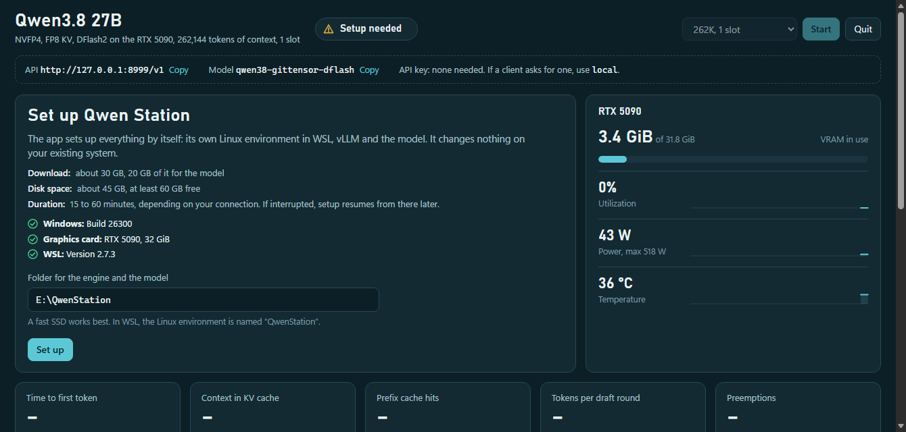

# Qwen Station

One file that installs and runs Qwen3.8 27B on a single RTX 5090, serves an OpenAI-compatible API and shows
what the model is doing. For Windows and for Linux.

- **Model:** Qwen3.8 27B as NVFP4 (Gittensor build for the RTX 5090), FP8 KV cache, DFlash2 drafter for
  speculative decoding
- **Engine:** vLLM 0.32.0 with five small patches and verified kernel tuning. On Windows it runs in its own
  WSL distribution, on Linux in one folder of your user.
- **API:** `http://127.0.0.1:8000/v1`, model `qwen38-gittensor-dflash`, no API key
- **Speed on the test machine:** it depends on what the model writes. Short prompts: about 160 tok/s for
  prose, 330 for code, 450 for step-by-step reasoning. Behind 137K tokens of context: 190, 240 and 320.
  Up to 262,144 tokens of context. [Details and how to measure it yourself](#speed).
- **Verified runs on LocalMaxxing**
  ([listed here](https://www.localmaxxing.com/en/models/gittensor-model-hub/Qwen3.8-27B-NVFP4-RTX5090)):
  381.5 tok/s on `reasoning-v1` and 293 tok/s on `code-v1` with the default setting; 439.9 and 290.5 tok/s
  with `draft_tokens` 15


## Requirements

- NVIDIA RTX 5090 (32 GB) with a current driver. The model file and the kernels are built for this card.
- 45 GB of free space on a built-in drive, ideally an SSD
- Internet for the setup: about 30 GB of downloads
- **Windows:** Windows 11, or Windows 10 from version 21H2. WSL 2 from version 2.4.4; the setup installs or
  updates WSL if needed (see below).
- **Linux:** x86_64, Python 3.10 or newer, bash, tar. A C++ compiler, make and curl; if they are missing, the
  setup names the one command that installs them.

## Install on Windows

1. Download `Qwen-Station-Setup-<version>.exe` from the
   [latest release](https://github.com/mfgAkilae/QwenStation/releases/latest) and start it. There is nothing
   to unpack. The file is not signed, so Windows SmartScreen warns: "More info", then "Run anyway".
2. The window lists what the machine needs and suggests a folder on the drive with the most free space.
   Click **Set up**.



That click is the only one. The setup then runs without further questions, and the model starts by itself
at the end. You can delete the downloaded file afterwards; the app starts from the Start menu.

| Step | What happens |
|---|---|
| App | Copies itself to `%LOCALAPPDATA%\Programs\Qwen Station`, adds Start menu and desktop shortcuts and an entry under Installed apps. No administrator rights needed. |
| WSL | Checks WSL. If it is missing, runs `wsl --install --no-distribution` (Windows asks for administrator rights). If Windows needs a restart, the app offers it and continues by itself after the next sign-in. An old WSL is updated. |
| Linux environment | Creates a WSL distribution named `QwenStation` in the chosen folder. Other distributions are not touched. |
| Engine | Installs a compiler, uv, Python 3.12, vLLM with PyTorch, the CUDA compiler, the patches and prebuilt GPU kernels. |
| Model | Downloads the model (17.9 GB) and the drafter (2.3 GB) from Hugging Face, pinned to fixed revisions. |

On a fast connection (about 35 MB/s) the whole setup took 7.5 minutes. Every step can be repeated: a cancelled or
failed setup continues where it stopped.

After the setup the model starts by itself. The first start takes two to three minutes, later starts 45 to 80 seconds.

A newer version updates an existing installation without a click: start the new exe, it replaces the app and
the changed parts of the engine and starts the model.

## Install on Linux

1. Download `Qwen-Station-Setup-<version>-linux.run` from the
   [latest release](https://github.com/mfgAkilae/QwenStation/releases/latest).
2. Run it: `sh Qwen-Station-Setup-<version>-linux.run`. There is nothing to unpack and nothing needs root rights.

On a desktop the window opens; click **Set up**. Without a desktop (a server, an SSH session) the setup starts
right away and prints its progress in the terminal.

| Step | What happens |
|---|---|
| App | The file installs the app into `~/.local/share/qwen-station/app`, the command `~/.local/bin/qwen-station` and a menu entry. |
| Engine | uv, a Python 3.12 of its own, vLLM with PyTorch, the CUDA compiler, the patches and prebuilt GPU kernels, all below one folder (default `~/.local/share/qwen-station`). |
| Model | Downloads the model (17.9 GB) and the drafter (2.3 GB) from Hugging Face, pinned to fixed revisions. |

If the system has no C++ compiler, the setup tries `sudo` without a password and the graphical password prompt.
If neither works it stops and shows the command to run once, for example
`sudo apt-get update && sudo apt-get install -y build-essential curl ca-certificates`. Then start the setup again.

Options go after the file name and on to the app:

```sh
sh Qwen-Station-Setup-<version>-linux.run --setup --location /data/qwen-station   # another folder, no click
sh Qwen-Station-Setup-<version>-linux.run --no-start                              # install the app only
qwen-station --no-window                                                           # later: start without a window
```

Without a desktop the dashboard is still there at `http://127.0.0.1:8010/`; reach it from another machine with
`ssh -L 8010:127.0.0.1:8010 <host>`. Ctrl+C, `kill` or a closed terminal stop the model in order. To keep it
running after you log out, start it in `tmux` or with `nohup qwen-station --no-window &`.

In a test on Ubuntu 24.04 the setup took 6.5 minutes on a 35 MB/s connection and used 28 GB.

## Use

- **OpenCode and Pi:** the app registers the model at every start (`~/.config/opencode/opencode.json` and
  `~/.pi/agent/models.json`, provider `vllm`). Before its first change it writes a backup next to the file.
- **T3 Code:** choose the provider OpenCode or Pi and the model `vllm/qwen38-gittensor-dflash`. If Pi does
  not list it, add it as a custom model with exactly this slug.
- **Other clients:** base URL `http://127.0.0.1:8000/v1`, any API key (for example `local`).
- **Reasoning effort:** `low`, `medium` or `xhigh`. This checkpoint knows no other levels.
- vLLM rejects `min_p` and `logit_bias` with HTTP 400 while speculative decoding is active.

Closing the window stops the model and frees the VRAM. A minimized window keeps it running. Starting the
app a second time only shows the window again.

### What the window shows

- Decode speed live (tok/s, averaged over 3 seconds) with a history of 5, 15 or 30 minutes
- GPU: VRAM, utilization, power, temperature
- Time to first token, KV cache fill level, prefix cache hit rate, tokens per draft round, preemptions
- The last requests: prompt tokens, cached tokens, output tokens, TTFT, speed, finish reason
- Draft acceptance per position of the DFlash2 drafter
- The server log, with a filter for warnings and errors

All values come from the `/metrics` endpoint of the vLLM server. Nothing sits in the request path: the API
is the unmodified vLLM endpoint.

### Free VRAM decides the context size

The card has 31.8 GiB; with the full context of 262,144 tokens the model takes about 30 GiB.

| Free at start | Behavior |
|---|---|
| 29.3 GiB or more | Full context |
| less | The context shrinks in steps of 32,768 tokens until the model fits. The window says so, and OpenCode and Pi get the smaller limit. |
| too little for 65,536 tokens | No automatic start. The window lists the programs that hold the most GPU memory. |

The reason: if the model does not fit, Windows pages GPU memory and the speed drops to a quarter (measured:
prefill 1,825 instead of 8,800 tok/s); on Linux the server runs out of GPU memory. Close other GPU programs
before starting to get the full context.

## Settings

Optional file `%LOCALAPPDATA%\QwenStation\qwen-station.json`, on Linux `~/.config/qwen-station/qwen-station.json`
(the setup creates it). All keys are optional:

```json
{
  "preset": "262k",
  "close_action": "stop",
  "autostart": true,
  "lan": false,
  "fit_context": true,
  "api_port": 8000,
  "station_port": 8010,
  "extra_args": "",
  "extra_env": ""
}
```

- `preset`: `262k` (default), `237k` (about 0.8 GB more VRAM headroom), `parallel-96k` (two slots,
  experimental) or `unsloth-82k` (Unsloth's NVFP4 build with the same drafter; needs
  `provision.sh model-unsloth` first: inside the distribution on Windows, in the engine folder on Linux).
- `close_action`: `stop` ends the model when the window closes, `keep` leaves it running until **Quit**.
- `lan`: `true` binds the API to `0.0.0.0`. On Windows it also sets up the port forwarding and a firewall rule
  for the private network (asks for administrator rights once); on Linux the firewall is yours to open. The API
  has no authentication, so the default is local only.
- `fit_context`: `false` switches the automatic context reduction off.
- `draft_tokens`: how many tokens the drafter proposes per round, 7 by default, up to 15. More makes reasoning
  17 to 30 percent faster and costs about 5,400 tokens of context each, see [Speed](#speed). Single-slot presets only.
- `extra_args`: appended to `vllm serve`. `extra_env`: `KEY=VALUE` pairs for the start script, for example
  `XQA_DECODE=0`.

The same values work as command line options: `Qwen-Station.exe --preset 237k --keep --no-autostart`, on Linux
`qwen-station --preset 237k --no-autostart`. `--check` prints the state of the installation as JSON and exits.
`--setup` starts a needed setup without the click, `--location` names its folder.

## Speed

Speculative decoding makes the speed depend on the text: the drafter proposes several tokens per round, the
model keeps the ones it would have written itself. The server does about 61 rounds per second with a short
context and 54 behind 137K tokens. Predictable text keeps more tokens per round.

Measured on 2026-11-17 with `tools/bench.py` (greedy, 768 output tokens, reasoning effort at its default, RTX
5090, context limit 163,840 tokens). Decode tokens per second, in brackets the tokens kept per round:

| Text the model writes | Short prompt | Behind 33K tokens | Behind 137K tokens |
|---|---|---|---|
| Prose (an essay) | 160 (2.5) | 217 (3.5) | 192 (3.5) |
| Code (a module with tests) | 331 (5.2) | 349 (5.7) | 238 (4.5) |
| Reasoning (a problem, step by step) | 451 (6.9) | 391 (6.4) | 323 (6.1) |

Reading the long contexts cold: 9,170 tok/s for 33K tokens (3.6 s), 4,060 tok/s for 137K tokens (34 s). With the
prefix in the cache the first token comes after 0.3 and 1.2 seconds.

### More draft tokens per round

The drafter was trained for blocks of 8 (7 draft tokens), but it keeps proposing useful tokens beyond that.
`draft_tokens` raises the number. Each round then takes a little longer, and the KV cache needs a state per
extra token, which costs context:

| `draft_tokens` | Prose | Code | Reasoning | Rounds per second (short, 137K) | Largest context with all VRAM free |
|---|---|---|---|---|---|
| 7 (default) | 160, 217, 192 | 331, 349, 238 | 451, 391, 323 | 65, 54 | 262,144 |
| 9 | 147, 206, 190 | 318, 298, 295 | 509, 461, 332 | 62, 53 | about 251,000 |
| 11 | 155, 188, 176 | 381, 280, 254 | 527, 443, 403 | 61, 47 | about 240,000 |
| 15 | 153, 216, 165 | 374, 300, 278 | 554, 461, 419 | 60, 46 | about 219,000 |

The three numbers per cell are tok/s for a short prompt, behind 33K and behind 137K tokens. Reasoning gains 17 to
30 percent with 11 or 15 draft tokens at every context size. Code gains with short prompts and varies behind long
contexts (these are single runs; code differs between runs). Prose loses up to 14 percent, because it keeps few
tokens anyway and the rounds get slower. The default stays 7: the largest context and the best speed for prose.

### Measure it yourself

```sh
python tools/bench.py --markdown                 # about five minutes against http://127.0.0.1:8000
python tools/bench.py --contexts 0 --repeats 3   # the short prompts only
```

The prompts are fixed and in the script. A row is marked when other requests ran on the server at the same time.

## Remove

Windows:

- **App:** Windows Settings, Apps, Installed apps, uninstall "Qwen Station".
- **Engine and model** (about 32 GB): `wsl --unregister QwenStation` in PowerShell.
- **Settings and logs:** delete `%LOCALAPPDATA%\QwenStation`.

Linux:

- **App:** `qwen-station --uninstall` removes the app files, the command and the menu entry.
- **Engine and model** (about 28 GB): delete the engine folder, by default `rm -rf ~/.local/share/qwen-station`.
- **Settings and logs:** delete `~/.config/qwen-station`.

## How it is built

Plain Python (3.10 or newer), standard library only. The Windows exe is a PyInstaller one-file build. The Linux
file is a shell script followed by a tar.gz of the same Python package.

| Path | Purpose |
|---|---|
| `qwen_station/app.py` | HTTP API for the dashboard, polling, window handling, entry point |
| `qwen_station/setup.py` | First-run setup: requirements, progress of the provisioning; WSL and the distribution on Windows, one folder on Linux |
| `qwen_station/installer.py` | Installs and removes the app itself (per user, no administrator rights) |
| `qwen_station/supervisor.py` | Preflight, start of the server (inside WSL or directly), startup phases from the log, stop |
| `qwen_station/metrics.py` | Parses `/metrics`; speed and request rows from counter differences |
| `qwen_station/gpu.py` | `nvidia-smi` readings, GPU memory per Windows process |
| `qwen_station/clients.py` | Entries for OpenCode and Pi |
| `qwen_station/dashboard.html` | The dashboard: one file, no external resources |
| `qwen_station/engine/provision.sh` | Installs the engine below one prefix. Idempotent, also runs on native Linux. |
| `qwen_station/engine/serve.sh` | Starts `vllm serve` with the tested settings |
| `qwen_station/engine/patches/` | Five idempotent patches for vLLM; each file explains its reason |
| `qwen_station/engine/autotune/` | Verified FlashInfer kernel tuning |
| `qwen_station/engine/engine.env` | Version pins: vLLM, Python, uv, CUDA packages, model revisions |

The reasons behind the engine settings, with the measurements, are in [docs/engine-notes.md](docs/engine-notes.md).

The dashboard listens on `127.0.0.1` only. Start, stop, setup and quit need a token that exists only in the
served page, so other websites cannot control the app.

### Develop

```powershell
python run-station.py --mock            # fake server instead of the model: the dashboard without a GPU
python run-station.py --check           # state of the installation as JSON
python -m unittest discover -s tests    # 62 tests; they start the mock server as a real subprocess
.\build-exe.ps1 -Release                # dist\Qwen-Station-Setup-<version>.exe with its SHA256 file
python build-linux.py                   # dist/Qwen-Station-Setup-<version>-linux.run with its SHA256 file
```

`build-exe.ps1` creates its own venv in `.build\` and installs PyInstaller there. `build-linux.py` needs nothing
but Python and runs on Windows and Linux alike. The tests pass on both; the ones about WSL and Windows paths
are skipped on Linux.

## License

Qwen Station is released under the [MIT License](LICENSE).

It does not ship vLLM, PyTorch or the model weights. The setup downloads them from PyPI and Hugging Face, and
each keeps its own license: vLLM, the model (`gittensor-model-hub/Qwen3.8-27B-NVFP4-RTX5090`) and the drafter
(`TechPrototyper/Qwen3.8-27B-DFlash2-fp8-vllm`) are Apache 2.0. The scripts in `qwen_station/engine/patches/`
change the installed vLLM on your machine.

## Tested, and not tested

Tested on 2026-11-17 on one machine (Windows 11, RTX 5090, WSL 2.7.3):

- **Windows**, with the release exe: uninstall, fresh setup into a new distribution, first start, benchmark,
  stop (1.0.0); updates to 1.1.0 and 1.2.0 without a click; 1.2.0 with `draft_tokens` 15, including the two
  LocalMaxxing runs.
- **Linux**, with the release file of 1.1.0 as a user without root rights, in a fresh Ubuntu 24.04: install,
  setup (including the stop at the missing compiler and the restart after installing it), first start,
  benchmark, stop by signal, uninstall. That Ubuntu ran inside WSL 2, because the test machine has no second
  operating system: kernel, file system and Python are Linux, the GPU driver is the one of Windows. For 1.2.0
  the Linux file was not installed again: its engine scripts ran in a Linux environment for all measurements
  above, and the unit tests pass on Linux.

Not tested on a real machine: Linux on bare metal with the native NVIDIA driver; the window on a Linux desktop
(only the terminal mode ran); distributions other than Ubuntu (the package manager commands for Fedora, Arch
and openSUSE are untested); the path where WSL is missing or outdated on Windows (covered by unit tests with a
faked WSL only); Windows 10; the `lan` option; the preset `parallel-96k` on the GPU.
